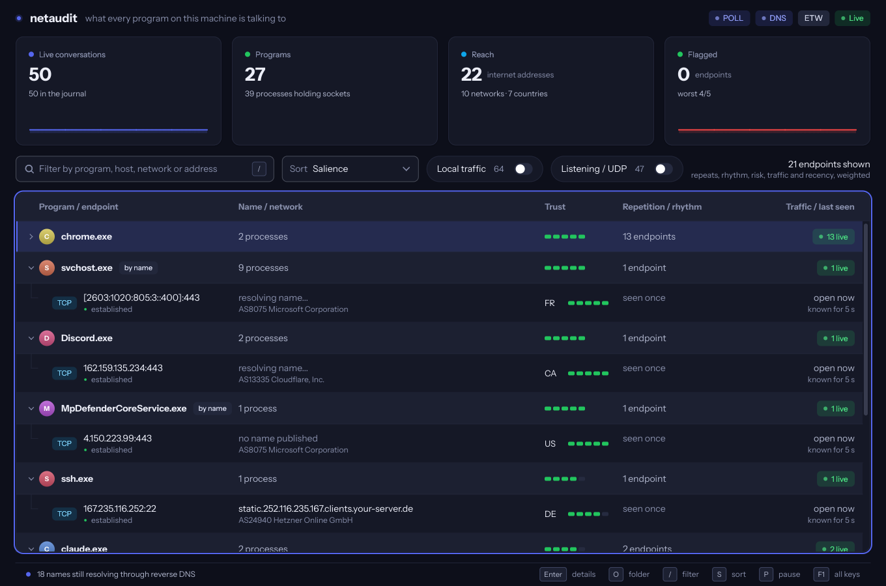

<div align="center">

# 🛰️ netaudit

### What every program on this machine is talking to — one window, in real time

<p align="center">
  <a href="https://axle-lang.dev"></a>
  <a href="https://github.com/Axle-lang/zaffre"></a>
  <a href="https://github.com/Axle-lang/smalt"></a>
</p>
<p align="center">
  
  
  
</p>



<sub>Written by the program itself — <code>--snap</code> draws one frame and puts it in a file.</sub>

<br>

<sub><a href="#the-idea">The idea</a> · <a href="#what-it-can-and-cannot-see">What it sees</a> · <a href="#it-refreshes-every-second-and-still-sits-still">Why it sits still</a> · <a href="#keys">Keys</a> · <a href="#building">Building</a> · <a href="#reading-the-source">Reading the source</a> · <a href="https://github.com/Axle-lang/zaffre">Zaffre ↗</a> · <a href="https://github.com/Axle-lang/smalt">smalt ↗</a> · <a href="https://axle-lang.dev">Axle ↗</a></sub>

</div>

---

## The idea

A connection list tells you a machine is talking to two hundred addresses.
That is not an audit; it is a haystack.

What separates one address from another is not volume but **shape**:

- a browser tab opens a burst of connections and stops;
- an update service reconnects every few hours, raggedly, because its timer drifts;
- **a beacon reconnects every thirty seconds, to the millisecond, forever.**

So netaudit is a tree, one row per **program**, folding open onto the addresses
it has been talking to. Every endpoint carries a ring of the instants it came
back, and three readings taken from that ring — the median gap, the wander
around it, and the steadiness that falls out.

The row says its reading in words:

```
×214 visits · every 30 s · clockwork
```

A window just opened has no rhythm to report and says `seen once`. The readings
fill in as the session runs — which is the whole point of a journal that
outlives what is live.

**The trust score is out of five and always explainable.** `Enter` opens a card
listing every signal that applied, with the points it cost or earned. A score
nobody can interrogate will be believed blindly or ignored entirely, and both
are worse than no score.

---

## What it can and cannot see

**There is no URL.** Windows does not record the path of an HTTP request
anywhere a tool can read, and HTTPS would encrypt it even if it did. Getting
one needs a proxy in the middle or a packet capture, and this is neither.

What it answers instead:

| Question | Where the answer comes from | Reading |
|---|---|---|
| which program, which protocol, which address and port | the per-process TCP/UDP tables (`iphlpapi`) | `POLL` |
| which **name** is behind the address | the machine's DNS cache, and reverse DNS | `DNS` |
| who **owns** the address, and where it is | `ip-api.com`, with Team Cymru's DNS whois behind it | `DNS` |
| how many **bytes** moved | a kernel ETW trace | `ETW` |
| the short connections polling misses | the same trace | `ETW` |

Three readings, three badges in the title bar. Each is lit when it is running,
and each explains itself when hovered.

> **`ETW` is declared and not implemented.** Its badge stays dark and the
> traffic column stays blank — and the badge is exactly why that is readable
> rather than misleading. A blank byte column with nothing to explain it says
> *these programs sent nothing*, which is the one thing it must never say.

**Two things are hidden by default**, each with its count on the toggle that
reveals it: traffic that never leaves the building (`L`), and sockets with no
peer — listening and UDP (`B`). Between them they are three quarters of the
rows on a working machine, and not one of them answers the question the window
is asking.

---

## It refreshes every second and still sits still

The machine underneath changes constantly. The window does not move under your
hand. Six rules, applied everywhere:

| | |
|---|---|
| **An endpoint is a journal entry, not a snapshot.** | A closed connection goes grey and stays five minutes after its last socket is gone, counts intact. A table of what is `ESTABLISHED` *right now* would flicker continuously, and would answer the wrong question. |
| **Identity is never an index.** | The selection is an endpoint key, the folds are group keys, the scroll is pixels. A rebuild cannot move any of them. |
| **The sort is damped, and freezes on hover.** | A row only overtakes its neighbour by a margin — and while the pointer is over the tree, nothing reorders at all. |
| **Figures are smoothed.** | A rate carries three quarters of the previous reading. |
| **It repaints on change, not on a clock.** | Idle, it sleeps in the OS. |
| **Enrichment lands quietly.** | A row completes in place; it does not jump. |

---

## Keys

| | |
|---|---|
| `↑` `↓` | move · `PgUp` `PgDn` `Home` `End` move further |
| `→` `←` | open and fold a program · `8` fold everything |
| `Enter` | the full sheet for the selected endpoint · a double click does the same |
| `O` | open the folder holding the program, binary selected |
| `S` | next ranking · the **Sort** field lists them all · `/` filter |
| `L` | also show local traffic · `B` also show listening and UDP sockets |
| `P` | pause · `R` or `F5` re-read now · `C` clear the journal |
| `F12` | write the window to `netaudit.bmp`, in the folder it was started from |
| `F1` or `?` | the key list · `Esc` close a sheet or clear the filter · `Q` quit |

`Space` pauses too, except on a row: with the tree focused it folds and unfolds
the program, as it does in any tree.

`Esc` never closes the window: a key pressed to dismiss something must not be
able to end the session you were in the middle of.

**The window resizes, and the layout follows.** The four figures share the
width, the tree grows to the bottom, and the badges stay anchored to the right
edge. The interface is [Zaffre](https://github.com/Axle-lang/zaffre)'s: rounded
surfaces, soft shadows, and a theme made of tokens rather than hand-picked
colours.

**The Sort field ranks by what it names**, and says beside the row count what
that ranking weighs. A program ranks by its best endpoint under the same
reading, so the program holding the steadiest timer is the one at the top of a
rhythm-sorted tree.

**A program's chevron folds it; the rest of its row selects it** — so a
program's totals are readable without closing what you were looking at.

**Enter explains.** The sheet shows a program's full image path, everything the
two lines of a row had to elide, and the score taken apart. A badge in the title
says what that reading is doing, and why, when the pointer rests on it.

---

## Where the names and the networks come from

Two sources. Neither needs a key or an account.

**`ip-api.com/batch`** — up to a hundred addresses per request: AS number and
name, country, city, operator, and the `proxy` / `hosting` / `mobile` flags.
One batch in flight, four and a half seconds apart (the service allows fifteen
batches a minute), exponential back-off on failure, and every address answered
exactly once per session. A batch that never arrived — the network was down, the
service said 429 — puts its addresses back in line; it is not read as "every
one of them came back empty".

**Team Cymru's DNS whois** — `x.y.z.w.origin.asn.cymru.com` and
`AS<n>.asn.cymru.com`, both `TXT`, for the addresses the batch could not name.
Each question is asked once per address, answered or not, so one address the
registry cannot place never holds up the rest.

<details>
<summary><b>Why the second one is DNS and not HTTP</b></summary>

<br>

`std::net`'s HTTP client speaks HTTP/1.1 and **not TLS**, so an `https://`
request from an Axle program cannot succeed. A registry fallback over HTTPS
would have been one that never once answered — and it would have looked
exactly like an address nobody could name. DNS needs no TLS, no key, and no
rate limit worth the name.

For the same reason there is **no blocklist signal** in the score. Every
keyless blocklist service is HTTPS-only, and a trust signal that can never fire
is worse than an absent one: it reads as evidence of innocence.

</details>

---

## Building

The interface, [Zaffre](https://github.com/Axle-lang/zaffre), is a submodule,
and so is the [smalt](https://github.com/Axle-lang/smalt) under it, so the clone
has to bring both:

```bash
git clone --recursive https://github.com/Axle-lang/netaudit
cd netaudit
axle build
./target/netaudit.exe
```

> An existing clone that predates the submodules: `git submodule update --init --recursive`.

**The only prerequisite is the Axle compiler, v0.18.1 or newer.** No SDK to
install, no DLL to copy beside the binary, no `[link]` section to fill in:
every OS library — `iphlpapi`, `dnsapi`, `kernel32`, `shell32`, and `gdi32`
through smalt — is named by the `extern "C" from "…"` block that imports from
it, so the link line learns of each from the declaration that needed it. The
one exception is `NtQuerySystemInformation`, bound by symbol from `ntdll`.

**Nothing needs elevation.** The connection tables, the resolver cache and
the reverse lookups are readable by any process. Run elevated, one thing
improves: the image paths of services running under another account become
readable, so `svchost` and friends are grouped by path rather than by name.
The kernel trace behind the `ETW` badge would need elevation too, and it is
not implemented.

**The resolver cache is read, never queried.** Each cached name is resolved
with `DNS_QUERY_NO_WIRE_QUERY`, so nothing about what this machine looked up
leaves it.

**`--snap <ms>`** waits that long, writes `netaudit.bmp`, and quits: a capture
for a report or for a script, with nobody standing over the machine at the
right moment. `F12` does the same on demand. A third argument says what to open
first: `--snap 5000 detail` is the sheet of the first endpoint, `help` the key
list, and `keys:/,g,i,t,h,u,b` plays those keys into the window — each letter
typed, a name such as `Down` or `Enter` pressed — which is how its keyboard is
checked without a keyboard.

---

<div align="center">

## Reading the source

<sub>Everything below is for someone opening the files, not running the binary.</sub>

</div>

### Layout

```
netaudit
├── axle.toml                  the package, the Zaffre and smalt path dependencies, the win32 port
├── src/
│   ├── main.axle              the loop: events in, a frame out, the readings and the two lookups in flight
│   ├── session.axle           what the loop owns: the world, the machine, the queue, the app
│   ├── app.axle               the interaction state, as the models the widgets are bound to
│   ├── fmt.axle               the figures a library cannot format: an address, a rate
│   │
│   ├── sys/                   the machine, as this program reads it
│   │   ├── machine.axle       the four readers, as one value
│   │   ├── raw.axle           the four pointer views the imports need — all the `unsafe`
│   │   ├── tiers.axle         which readings are running, and why the others are not
│   │   └── win32/             ← the one directory that names an operating system
│   │       ├── conn.axle      GetExtendedTcp/UdpTable, v4 and v6, one row shape
│   │       ├── procs.axle     process names, and where each binary lives
│   │       ├── dnscache.axle  the resolver's cache, inverted to address → name
│   │       ├── rdns.axle      the PTR record, for what nothing else could name
│   │       └── shell.axle     explorer.exe /select,"…"
│   │
│   ├── model/                 the journal, and every reading taken off it
│   │   ├── world.axle         the six tables below, as one value
│   │   ├── pool.axle          interned text — nothing here is ever a `string`
│   │   ├── key.axle           the one hash every identity is folded with
│   │   ├── addr.axle          loopback / private / public, and how an address is keyed
│   │   ├── hosts.axle         one row per address: name, network, place, flags
│   │   ├── endpoints.axle     the journal, and the salience the tree ranks by
│   │   ├── rhythm.axle        the arrival ring, and the period and steadiness from it
│   │   ├── groups.axle        one row per program, keyed on the image path
│   │   ├── score.axle         the trust reading, and the nine reasons behind it
│   │   ├── view.axle          the flattened tree: which rows, in what order, how tall
│   │   └── pulse.axle         the four headline figures, sampled once a tick
│   │
│   ├── enrich/                who owns an address, asked over the network
│   │   ├── queue.axle         who gets looked up, how often, and the back-off
│   │   ├── worker.axle        the one blocking call, on a thread of its own
│   │   ├── scan.axle          values out of a JSON response, byte by byte
│   │   ├── ipapi.axle         the batch response, folded into rows
│   │   └── cymru.axle         the registry over DNS, for what the batch could not name
│   │
│   └── ui/                    the window, in Zaffre's components; nothing here reads the machine
│       ├── page.axle          the one page: title, figures, filter, tree, status bar
│       ├── journal.axle       the tree as a `DataGrid` sees it: a source over the model's rows
│       ├── figures.axle       what is rebuilt from the model: the figures, the badges, the count
│       ├── live.axle          `Rebuilt`: a child made again whenever the model moves
│       ├── root.axle          the window's own keys, and the sheets that open over the page
│       ├── detail.axle        the endpoint sheet, and the key list
│       ├── actions.axle       open a folder, clear the journal, fold everything
│       └── text.axle          bytes in the pool and the formatting cursor, as `string`
│
├── doc/netaudit.png           this page's screenshot, written by `--snap`
└── vendor/zaffre              the interface library, as a submodule
    └── vendor/smalt           and the platform layer under it, the library's own submodule
```

**One directory names an operating system, and `axle.toml` says which.**
`[port.win32]` binds `when = { os = "windows" }` to `dirs = ["win32"]`, so
`use crate::sys::conn::Conns` resolves to `sys/win32/conn.axle` on Windows and
would resolve to a sibling directory's file on another target.

Everything above `sys/` — the model, the enrichment, the whole UI — names no OS
at all. That is what makes a second port six files and no edit anywhere else.
`axle ports` prints the table with a tick per seam.

### What it stands on

Two libraries, both Axle's, both submodules.

**[smalt](https://github.com/Axle-lang/smalt)** is the platform: the window, the
surface, the event queue, the clock, the byte pool, the slot index, the
formatter and the BMP writer. There is exactly one copy of it — the one Zaffre
was written against — and `axle.toml` points this program at that one, so the
interface and the readers never disagree about a type.

**[Zaffre](https://github.com/Axle-lang/zaffre)** is the interface, written from
what this program used to draw by hand: a `DataGrid` that asks only for the rows
in view, `Stat`, `SearchInput`, `ToggleChip`, `ScoreMeter`, `StatusBar`,
`ReasonList`, `Sheet`. The program supplies what a library cannot know — the
journal, and what each cell of it says — and Zaffre supplies everything that
looks like something.

Four things are worth naming.

**The grid keeps what the reader did, and the program keeps the data.** The pick
is a key, the scroll is pixels, and whether the pointer is over the rows is a
flag both sides can read. The journal is re-read every second and the tree is
rebuilt from it, and none of the three can come to mean a different row because
of that.

**The loop sleeps in the OS.** `Events::wait` blocks until an event arrives, an
animation needs a frame, or the next reading is due. Idle and paused, this
program uses no measurable CPU at all — which a poll-and-sleep loop cannot say,
whatever the sleep, and which a tool that measures the machine owes it. The loop
is this program's own rather than Zaffre's `App::run`, because the readings and
the two lookups in flight have to be turned over on the same thread that draws.

**What changes once a second is made again; what does not is made once.** A
`Stat` holds the text it was built with, so the figures, the badges and the row
count are each a `Rebuilt`: a child made afresh when the stamp the loop bumps at
each reading has moved. A frame that only animates allocates nothing.

**Text is drawn from bytes, and handed to a widget as a string only at the last
step.** Every name lives in one pool and is referred to by an offset and a
length; `ui/text.axle` is the one door out of it. The path `O` hands to
`ShellExecuteW` is the UTF-16 Windows gave, kept beside the drawable copy, so a
folder with an accent in its name still opens.

What stays here is what a library cannot know: an address in its canonical text
form, a rate whose empty case means *nothing measured bytes* rather than
*nothing was sent*, and the fold the identity indexes are keyed on.

### How it is written

Four habits, each turning a class of silent mistake into a compile error or a
signature that says what it touches.

**What travels together is one value.** `Session` is what the loop owns, `World`
the six model tables, `Machine` the four OS readers, `Lens` what the reader asked
the tree to show, and `Sighting`, `Obj` and `Bytes` are the small values a
socket, a JSON object and a span of text are. Axle's borrows are second-class
(E0513 — a reference lent for a call cannot be kept in a field), so what several
widgets hold at once is a `Shared<Session>`, and what a widget keeps for itself
is passed `own`. The four Win32 imports keep their six arguments: those
signatures are Windows's, not ours.

**Every state is an enum, read by a `match` with no wildcard** — `Tier`,
`TierState`, `Sort`, `RowKind`, `Say`, `Proto`, `SocketKind`, `Reach`, `Look`,
`NameSource`, `PathState`, `WhoisKind`, `Signal`. The columns included: they are
`Reach[]` and `Look[]`, not `i32[]`. The wildcards left are on integers (a TCP
state number, an index into a cycle) and on the keys and events this window does
not answer. The trust score reads the same nine-arm table the sheet lists, so a
signal cannot be scored without being explained.

**A function name is the crate's, not the module's.** Axle resolves top-level
names across the whole crate, so `address` in `ui/detail` could not coexist with
`fmt::address`, and the model's `View` and `Reason` became `Rows` and `Signal`
rather than shadow Zaffre's. A class is declared before the code that hands it
to a trait object — which is why `ui/figures` is a file of its own.

**All the `unsafe` is in one file.** `src/sys/raw.axle` holds the four views
between an address and a `ptr` that the Windows imports need; smalt owns the raw
reads and writes. `unsafe` is per-function in Axle (E0707 — it does not
propagate across a call), so that confinement is enforceable rather than
aspirational: `grep -rlE "unsafe (fn|\{)" src/` returns one file.

**The interface is set in Instrument Sans**, which Zaffre embeds; the font is
under the SIL Open Font License (`vendor/zaffre/assets/fonts/InstrumentSans-OFL.txt`).

---

<div align="center">
<sub>MIT — see <a href="LICENSE">LICENSE</a>.</sub>
</div>
